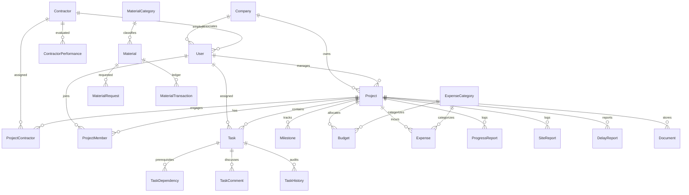

# BuildTrack — PostgreSQL Database Design & Architecture

## Overview

BuildTrack uses **PostgreSQL (Neon Serverless)** managed through **Prisma ORM** (`prisma/schema.prisma`) across **25 relational models** organized into five enterprise domains.

---

## Domain Table Registry (25 Models)

### 1. Core Governance & Auth
| Table | Purpose | Key Columns & Indexes |
| :--- | :--- | :--- |
| `Company` | Enterprise tenant organization | `id`, `name`, `email`, `phone` |
| `User` | Authenticated platform users (5 RBAC roles) | `id`, `email` (`@unique`), `role`, `status`, `contractorId`, `companyId` |
| `Notification` | Real-time alerts (Overdue, Budget Overrun, Low Stock) | `id`, `userId`, `type`, `isRead`, `createdAt` (`@@index([userId, isRead, createdAt])`) |
| `ActivityLog` | Immutable enterprise audit trail | `id`, `actorId`, `action`, `entity`, `entityId`, `createdAt` |

### 2. Projects, Workforce & CPM Scheduling
| Table | Purpose | Key Columns & Indexes |
| :--- | :--- | :--- |
| `Project` | Construction megaprojects | `id`, `name`, `location`, `totalBudget`, `status`, `progress`, `managerId` |
| `ProjectMember` | Project team membership & authorization | `projectId`, `userId`, `role` (`@@unique([projectId, userId])`) |
| `Contractor` | Trade & prime contractor directory | `id`, `company`, `specialty`, `rating`, `status` |
| `ProjectContractor` | Many-to-many project-contractor allocations | `projectId`, `contractorId`, `role` (`@@unique([projectId, contractorId])`) |
| `ContractorPerformance` | SLA & quality evaluation history | `id`, `contractorId`, `qualityScore`, `onTimeRate`, `evaluatedAt` |
| `Milestone` | Project phase milestones | `id`, `projectId`, `title`, `targetDate`, `status`, `completedDate` |
| `Task` | Work packages with soft-delete & progress | `id`, `projectId`, `assigneeId`, `priority`, `status`, `progress`, `deadline`, `isDeleted` |
| `TaskDependency` | Directed Acyclic Graph (DAG) prerequisites | `taskId`, `dependsOnId` (`@@unique([taskId, dependsOnId])`) |
| `TaskComment` | Task discussion threads | `id`, `taskId`, `userId`, `content`, `createdAt` |
| `TaskHistory` | Immutable task transition & update history | `id`, `taskId`, `userId`, `action`, `from`, `to`, `createdAt` |

### 3. Financials & Earned Value
| Table | Purpose | Key Columns & Indexes |
| :--- | :--- | :--- |
| `ExpenseCategory` | Standardized cost codes | `id`, `name`, `code` (`@unique`) |
| `Budget` | Project-category capital allocations | `projectId`, `categoryId`, `allocated` (`@@unique([projectId, categoryId])`) |
| `Expense` | Certified expenditure records & vouchers | `id`, `projectId`, `categoryId`, `amount`, `date`, `recordedById`, `documentUrl` |

### 4. Supply Chain & Material Inventory
| Table | Purpose | Key Columns & Indexes |
| :--- | :--- | :--- |
| `MaterialCategory` | Material divisions | `id`, `name` |
| `Material` | Warehouse SKUs with stock & reorder thresholds | `id`, `sku` (`@unique`), `unit`, `availableQty`, `reorderLevel`, `unitCost` |
| `MaterialRequest` | Site material indent workflow | `id`, `materialId`, `projectId`, `requesterId`, `qty`, `status` |
| `MaterialTransaction` | Immutable stock ledger (`RECEIVE`, `ISSUE`, `CONSUME`, `ADJUST`) | `id`, `materialId`, `type`, `qty`, `balanceAfter`, `createdAt` |

### 5. Field Operations & Documents
| Table | Purpose | Key Columns & Indexes |
| :--- | :--- | :--- |
| `ProgressReport` | Daily task/project progress updates with photos | `id`, `projectId`, `taskId`, `percentage`, `photos`, `reportedById`, `date` |
| `SiteReport` | Daily HSE, weather, workforce, and safety logs | `id`, `projectId`, `reportedById`, `weather`, `workersCount`, `safetyIncidents` |
| `DelayReport` | Schedule slippage forensics | `id`, `projectId`, `taskId`, `reason`, `delayDays`, `impactLevel` |
| `Document` | Blueprint, IPC, and QA document vault | `id`, `projectId`, `title`, `category`, `fileUrl`, `uploadedById` |

---

## Integrity & Business Rules Enforced at Database/Server Level

- **Server-Side Financial Calculations**: Total budget, incurred expenses, remaining reserve, utilization %, and overrun flags are computed exclusively on the server.
- **DAG Cycle Prevention**: `TaskDependency` insertions validate via DFS graph traversal (`lib/business-rules.ts`) to prevent circular dependencies.
- **Atomic Stock Control**: `Material` dispatches and consumptions execute inside Prisma `$transaction` blocks preventing negative stock (`HTTP 409 INSUFFICIENT_STOCK`).
- **Audit Retention**: Completed tasks retain `TaskHistory` records; user deactivation soft-suspends accounts rather than cascading deletes on audit trails.

